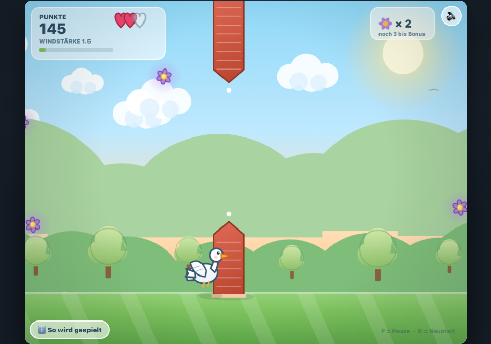

# Goose Run 🪿

Ein kleines Arcade-Spiel für den Browser: Du steuerst eine Gans über Felder und Bauernhöfe, weichst Hindernissen aus und sammelst Gänseblumen.

**Spielen:** `index.html` einfach im Browser öffnen – keine Installation, kein Build, kein Internet nötig.



## Spielprinzip

- **Ausweichen:** Bauernhoftore, Scheunendächer, Heuballen und entgegenkommende Möwen.
- **Sammeln:** Gänseblumen geben Punkte; schnell hintereinander gesammelt steigt der Combo-Multiplikator (bis ×5). Alle 5 Blumen gibt es einen Bonus.
- **Power-ups:** Korn (schneller), Feder (kurz unverwundbar), Magnet (zieht Blumen an).
- **Leben:** 3 Herzen; nach einem Treffer bist du kurz unverwundbar (Blinken).
- **Schwierigkeit:** Steigt mit der Zeit, angezeigt als „Windstärke“.
- **Highscore:** Wird im Browser gespeichert (`localStorage`).

## Steuerung

| Eingabe | Aktion |
|---|---|
| ↑ / ↓ oder W / S | Gans hoch / runter bewegen |
| ← / → oder A / D | Vor / zurück |
| Leertaste | Flattern (kurzer Boost) |
| Maus / Finger | Gans folgt dem Zeiger |
| P oder Esc | Pause |
| R | Neustart |
| 🔊 / 🔇 | Ton an/aus |
| ℹ️ | „So wird gespielt“ |

## Technik

- Eine einzige Datei: `index.html` (HTML + CSS + JavaScript, ca. 1.900 Zeilen).
- Rendering über Canvas 2D mit `requestAnimationFrame` und DeltaTime-Deckel (50 ms) – läuft unabhängig von der Bildwiederholrate, kein Sprung nach Tab-Wechsel.
- Alle Grafiken werden prozedural gezeichnet, Soundeffekte synthetisch über die WebAudio-API erzeugt.
- **Keine** externen Abhängigkeiten, CDN-Links oder Netzwerk-Requests – das Spiel funktioniert auch offline.
- Aufbau im Code: Zustände (Start / Spiel / Pause / Ende), Spawn-System mit `laneFreeY`, Kollisionsprüfung mit Unverwundbarkeit, Partikel- und Text-Popup-System, Highscore per `localStorage`.

## Dateien

```
index.html   das komplette Spiel
README.md    diese Beschreibung
screenshot.png (optional) Vorschau für GitHub
```

## Entwicklung

Änderungen werden direkt in `index.html` gemacht. Nach jeder Änderung prüfen, dass das Spiel ohne Konsolenfehler läuft (Browser-Konsole oder `node --check` auf dem Script-Block), dann committen und pushen.
